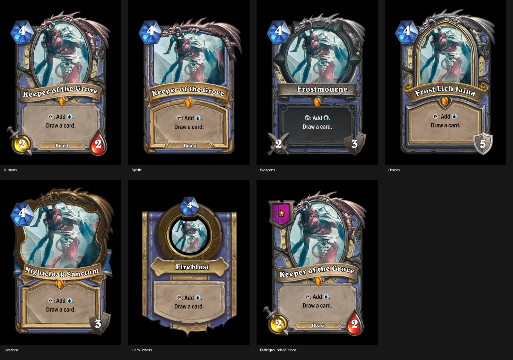

# Hearthstone frames

Choose **Frame → Other Games → Hearthstone**, select a card type, class and
components, then click **Build / replace Hearthstone layers**.



| Layout | Cost / special components | Stat fields |
| --- | --- | --- |
| Minions | Mana crystal, optional tribe, rarity gem and legendary dragon | Power, Toughness |
| Spells | Mana crystal, optional school/type, rarity gem and spell dragon | None |
| Weapons | Mana crystal, optional type plaque, rarity gem and weapon dragon | Attack, Durability |
| Heroes | Mana crystal, rarity gem and hero dragon | Armor |
| Locations | Mana crystal, rarity gem and location dragon | Durability |
| Hero Powers | Universal Hero Power frame with central mana crystal | None |
| Battlegrounds Minions | Selectable tavern tier 1–6 badge, optional tribe and rarity components | Power, Toughness |

All eleven classes and Neutral are selectable for every layout. Hero Powers use
the game's universal frame; their selected class is retained in the saved card.
Battlegrounds minions use the normal minion class frames with a tier badge in
place of the mana crystal. Layouts expose their own compatible components and
text fields, so a spell never inherits minion stats and a hero uses Armor.

The class body, art surround, text scroll, name ribbon, cost crystal, stat
symbols, type plaque, rarity socket/gem, dragon and tier badges are ordinary
independent frame layers. Select them in the frame picker, or use the builder
checkboxes. The stock frame editor supports reordering, masks, position, opacity
and color changes. On Weapons, select **Type indicator** to enable the optional
tribe/type text field. Unsupported component controls are disabled.

Names use **Belwe Bd BT Bold**, with individually rotated glyphs along the
appropriate minion, spell, weapon, hero, location or Hero Power path. Long names
shrink to fit. [Original-card name comparison](images/hearthstone-original-name-comparison.jpg).
Rules use the shared Card Conjurer replacement engine: `{t}`, `{untap}`, `{w}`,
`{u}`, `{b}`, `{r}`, `{g}`, hybrid mana, bold, italics and normal commands remain
available. Weapon rules default to white on their dark scroll. Cost and stat
fields accept ordinary numbers. Art remains editable in the Art tab.

Build replaces the extension's generated layers and restores their template
positions; adjust individual layer positions after building. Other frame layers
are retained underneath. Compatible text and art are preserved between class
changes. A simple imported MtG `2/4` becomes the separate minion stats. The normal
save/reload and PNG download workflows preserve the selected type, class, text,
layer edits, tier and art. Hearthstone saves also retain the exact art pose so
reopening a bleed card does not accumulate the shared loader's pixel rounding.

## Print margins

Check **1/8-inch black margins** before building. A 2.5 × 3.5-inch trim card gets
exactly 0.125 inch on every side (`marginX = 0.05`, `marginY = 1/28`). The default
2010 × 2814 canvas becomes 2211 × 3015 pixels. The black surround covers the full
bleed and all space outside the irregular frame, leaving the art aperture clear.
Art fits slightly beneath the frame to prevent subpixel gaps at preview and print
scales. Keep **Hearthstone Black Surround / Bleed** below the other components.
The existing generic **1/8th Inch Margin** frame group also works with its usual
margin geometry.

## Assets and implementation

Outside the extension, changes are limited to the Hearthstone option in
`creator/index.html` and resetting the active text-field index when loading a
card in `js/creator-23.js`. That small guard prevents loading a layout with fewer
text fields from crashing. The shared drawing and replacement engines and
original frame classes are unchanged.

Frames and components are adapted from
[Vincent-the-gamer/CardForge](https://github.com/Vincent-the-gamer/cardforge),
revision `97ae1468ec3bcc089a13913b89541e319ba30f88`. Its MIT license is included in
`img/frames/hearthstone/LICENSE-CardForge.txt`.

The Hero Power frame and reference title paths come from
[HearthSim/Sunwell](https://github.com/HearthSim/Sunwell), revision
`e6c4dc118a76e5b15e65d1897625c4f266c4d44e`. Its MIT license is included in
`img/frames/hearthstone/LICENSE-Sunwell.txt`. CardForge source positioning is in
`src/components/Card/{Minion,Spell,Weapon,Hero,Location,BattlegroundsMinion}.vue`.
Sunwell's `HeroPowerCard.ts` supplies the universal layout.

Regenerate the checked-in assets and thumbnails with Pillow:

```sh
python tools/build_hearthstone_assets.py /path/to/cardforge /path/to/sunwell
```

The application has no new runtime dependencies and serves the fonts and assets
locally. Belwe is sourced from wnr/firestone-view, `asset/font/belwe-bd-bt-bold.ttf`;
its embedded family is **Belwe Bd BT**, style **Bold**. This proprietary font is
not covered by the projects' MIT licenses; see `fonts/hearthstone/NOTICE.txt`.
The other preexisting Hearthstone text fields retain the CardForge font assets.
Hearthstone and original game artwork are associated with Blizzard Entertainment.
This is an unofficial custom card frame extension.

The typography was compared against original
[Keeper of the Grove](https://raw.githubusercontent.com/schmich/hearthstone-card-images/master/cards/en_US/601.png)
and [Fireball](https://raw.githubusercontent.com/schmich/hearthstone-card-images/master/cards/en_US/315.png)
images mirrored by schmich/hearthstone-card-images.

## Verification

Start the application server at localhost:4242, then run:

```sh
python tests/hearthstone_matrix_browser.py
python tests/hearthstone_names_browser.py
python tests/hearthstone_type_names_browser.py
python tests/hearthstone_browser.py --quick
```

The matrix exercises **7 layouts × 12 classes = 84 combinations** in Chromium.
Class coverage uses the half-resolution application canvas; every layout is also
checked at full print resolution. Checks include real asset loading, the correct
text/stat fields, all six BG tier badges, full output opacity, every pixel of all
four bleed strips, irregular trim corners, actual MtG symbol rendering, independent
component removal, fresh-page save/reload, real PNG download and mobile controls.
The separate name checks cover short and long titles, legacy save migration,
and monotonic glyph placement on every type's title path.
The earlier general browser suite also checks the stock text/layer editors,
generic margin workflow and switching back to regular MtG.

Tests require Python Playwright, Pillow and `/usr/bin/chromium`. Artifacts go under
`work/`; the matrix accepts `--output`, `--quick`, and `--kinds` for focused checks.
[Recorded verification results](hearthstone-verification.json).

Browser screenshots: [all types](images/hearthstone-all-types.jpg),
[minions](images/hearthstone-editor-minion.png),
[spells](images/hearthstone-editor-spell.png),
[weapons](images/hearthstone-editor-weapon.png),
[heroes](images/hearthstone-editor-hero.png),
[locations](images/hearthstone-editor-location.png),
[Hero Powers](images/hearthstone-editor-hero-power.png),
[Battlegrounds minions](images/hearthstone-editor-battleground-minion.png),
[mobile controls](images/hearthstone-mobile-controls.png).
