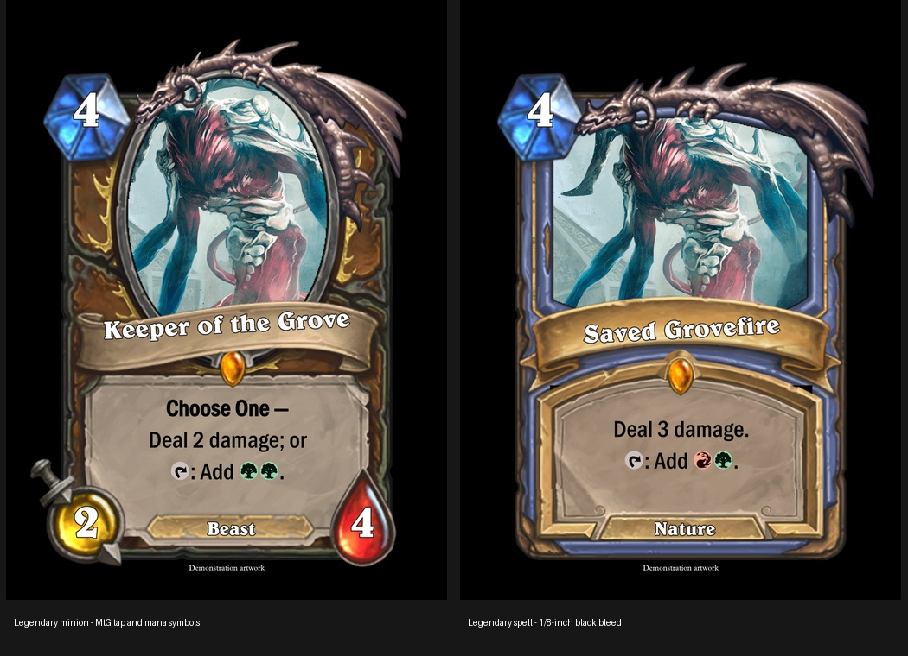

# Hearthstone frames



In **Frame → Other Games → Hearthstone**, choose **Hearthstone Minions** or
**Hearthstone Spells**. Select a class, rarity and components, then click
**Build / replace Hearthstone layers**. This assembles the card; choosing a frame
version alone configures the text and art bounds, as with other Card Conjurer packs.

All eleven classes and Neutral are included. The class body, portrait border,
text scroll, name ribbon, mana crystal, sword, health gem, type indicator,
rarity socket/gems and legendary dragon are separate ordinary frame layers.
Use the existing frame picker to add individual components, and the frame list
to reorder, mask, move, recolor, change opacity or remove them. Minions use the
oval portrait and `minion-dragon`; spells use the spell surround and
`spell-dragon`. Spells omit the minion stats. To omit a type plaque or dragon,
uncheck it before building, or remove its layer afterwards.

**Text** provides Title, Mana cost, Type / tribe (for example Beast or Nature),
Rules Text and, for minions, separate Power and Toughness fields. Cost and stats
accept plain numbers. Rules use the standard Card Conjurer replacement engine:
`{t}`, `{untap}`, `{w}`, `{u}`, `{b}`, `{r}`, `{g}`, hybrid mana, `{bold}…{/bold}`,
italics and other normal commands remain available. Existing title, cost, type,
rules and art survive a class change; a simple imported MtG `2/4` becomes the
separate minion stats. Art remains editable in the standard Art tab.

Build replaces the extension's generated layers. Manually positioned components
should be adjusted **after** building; rebuilding intentionally restores those
components to their template positions. Other frame layers are retained beneath
the assembled Hearthstone card. Normal save, reload and PNG export preserve the
individual layers, text, fonts, art and settings.

## Print margins

Check **1/8-inch black margins** before building. On a 2.5 × 3.5-inch trim card,
the extension adds exactly 0.125 inch on every side (`marginX = 0.05`,
`marginY = 1/28`); the default 2010 × 2814 canvas becomes 2211 × 3015 pixels.
The black surround covers the full bleed and all spaces outside the irregular
frame while leaving the portrait aperture clear for art. The generic
**1/8th Inch Margin** frame group also works using its existing margin geometry.
Keep the **Hearthstone Black Surround / Bleed** layer beneath the other components.

## Implementation and assets

The sole integration change is the Hearthstone option in `creator/index.html`.
The group and pack scripts, shared extension, fonts and artwork are new files;
the existing renderer, replacement engine and save logic are unchanged.

Artwork and fonts are adapted from
[Vincent-the-gamer/CardForge](https://github.com/Vincent-the-gamer/cardforge),
revision `97ae1468ec3bcc089a13913b89541e319ba30f88`. The upstream MIT license is
included in `img/frames/hearthstone/LICENSE-CardForge.txt`. Hearthstone and its
card artwork are associated with Blizzard Entertainment; this is an unofficial
custom card frame extension.

`tools/build_hearthstone_assets.py /path/to/cardforge` reproducibly separates and
positions the source assets on a 5:7 trim canvas and generates picker thumbnails.
It requires Pillow, but the application has no additional runtime dependencies.
Source positioning references are `src/components/Card/Minion.vue` and
`src/components/Card/Spell.vue`. Fonts load locally through the saved card's
`onload` script, including when reopening a save in a fresh browser session.

## Browser verification

Run the existing application server, then:

```sh
python tests/hearthstone_browser.py
```

The test requires Python Playwright, Pillow and `/usr/bin/chromium`. It uses a
bright test pattern by default; `--art /path/to/art.png` supplies real art.
It exercises all 24 class/type combinations, legendary dragons, component
selection, actual MtG symbol image rendering, every pixel of the four black
bleed strips, irregular trim corners, fresh-page save/reload, edited layer
positions and opacity, generic margins, switching back to regular MtG, PNG
download and mobile controls. Screenshots and results are written under
`work/hearthstone-verification` (override with `--output`).

The completed browser run passed all 24 variants with zero page errors or failed
extension asset requests. A final focused run also exercised the actual text and
frame editor inputs, rescanned the generic margins, and rechecked the adjusted
spell dragon. See [recorded results](hearthstone-verification.json).

Browser screenshots: [minion editor](images/hearthstone-editor-minion.png),
[spell editor](images/hearthstone-editor-spell.png),
[mobile controls](images/hearthstone-mobile-controls.png),
[all minion classes](images/hearthstone-minion-classes.jpg),
[all spell classes](images/hearthstone-spell-classes.jpg).
